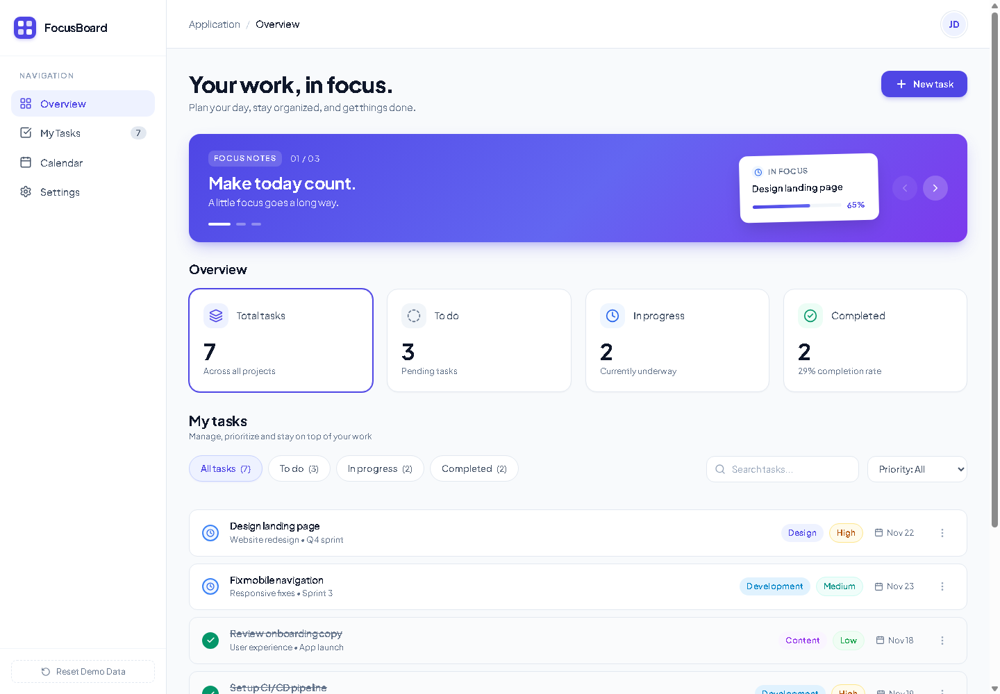

# FocusBoard — Full-Stack Task Management & Analytics Platform

FocusBoard is an enterprise-grade, responsive task management dashboard and productivity platform developed by **Sheik Mubashir Hussen**.

Originally initiated as a high-fidelity frontend based on live Figma design specifications, the system has evolved into a robust **Full-Stack Application** featuring secure JWT multi-user authentication, tenant data isolation, advanced productivity analytics, formula-safe CSV reporting, PostgreSQL database support with Alembic migrations, and automated multi-stage Docker containerization.

---

## Candidate Submission Information

- **Candidate:** Sheik Mubashir Hussen
- **Frontend Stack:** React 19 + Vite 8 + Pure CSS3 + Lucide React
- **Backend Stack:** FastAPI (Python 3.10+) + SQLAlchemy 2 + Alembic + Pydantic v2 + Bcrypt + PyJWT
- **Database:** PostgreSQL (Production / Docker) & SQLite (Local / Fast Testing)
- **Containerization:** Docker & Docker Compose (Frontend, Backend, PostgreSQL)
- **Live Demo:** https://focusboard.vercel.app *(or your configured live deployment)*
- **GitHub Repository:** https://github.com/mubashirhussen/FocusBoard

---

## 1. Key Capabilities & Architecture

### Full-Stack Authentication & Security (Phase 11)
- **Stateless JWT Authentication**: Secure HMAC-SHA256 bearer tokens with 24-hour expiry.
- **Bcrypt Password Hashing**: Cryptographically salted passwords using native bcrypt (never plaintext, never logged).
- **Strict Tenant Isolation**: All task queries enforce `Task.user_id == current_user.id` at the database level. Attempted access to other users' tasks yields `404 Not Found` (mitigating ID enumeration).
- **Graceful Dual Mode**: Supports both authenticated cloud synchronization and seamless offline/guest localStorage operation.
- **1-Click Demo Login**: Built-in instant login for evaluators and recruiters.

### Advanced Productivity Analytics & Reporting (Phase 13)
- **Task Lifecycle Timestamps**: Automatic `completed_at` tracking when tasks transition to "Completed", reset if reopened.
- **Real-Time Velocity Metrics**: Dynamic completion rate, pending task breakdown, and overdue deadline alerts.
- **Historical Trends**: Customizable 7-day, 30-day, and 90-day task completion vs. creation charts.
- **Distribution Breakdowns**: Instant breakdown across task status, priority levels, and work categories.
- **AI Productivity Insights**: Algorithmic performance analysis highlighting velocity, overdue deadlines, and top categories.
- **Formula-Safe CSV Export**: CSV export featuring defense against spreadsheet formula injection (CWE-1236 / CSV Injection) by sanitizing `=`, `+`, `-`, and `@` triggers, encoded with UTF-8 BOM for Microsoft Excel compatibility.

### Production Infrastructure & Dockerization (Phase 12)
- **Containerized Microservices**: Orchestrated with `docker-compose.yml` including:
  - `postgres`: PostgreSQL 16 Alpine with persistent volume and healthcheck probes.
  - `backend`: FastAPI Python 3.10 slim, non-root user, multi-worker Uvicorn, healthcheck probe.
  - `frontend`: Multi-stage build (Node 20 build -> Nginx Alpine static server with gzip compression and SPA HTML5 routing fallback).
- **Alembic Database Migrations**: Reproducible database schema versioning with automated upgrade workflows.
- **Observability & Health Checks**: Correlation ID middleware (`X-Request-ID`), structured logging, `/health` liveness probe, and `/ready` database readiness probe.

---

## 2. Screenshots

### Desktop Dashboard (1440px)


### Mobile Dashboard (390px)


---

## 3. Directory Layout

```
focusboard/
├── docker-compose.yml              # Production orchestration (Postgres, Backend, Frontend)
├── Dockerfile                      # Multi-stage Node + Nginx Alpine frontend container
├── nginx.conf                      # Production Nginx SPA configuration & compression
├── package.json                    # React frontend dependencies & scripts
├── vite.config.js                  # Vite bundler configuration
│
├── backend/                        # FastAPI Backend Application
│   ├── app/
│   │   ├── main.py                 # FastAPI instance, CORS, Request ID middleware
│   │   ├── core/
│   │   │   ├── config.py           # Pydantic BaseSettings environment configuration
│   │   │   └── security.py         # Bcrypt hashing & JWT token issuance/verification
│   │   ├── db/
│   │   │   └── database.py         # SQLAlchemy engine, session maker, get_db dependency
│   │   ├── models/
│   │   │   ├── user.py             # User SQLAlchemy model (email, password hash, role)
│   │   │   └── task.py             # Task SQLAlchemy model (user_id FK, completed_at)
│   │   ├── schemas/
│   │   │   ├── auth.py             # Auth & Login Pydantic schemas
│   │   │   ├── user.py             # User request/response schemas (no hash leakage)
│   │   │   ├── task.py             # Task CRUD schemas with camelCase compatibility
│   │   │   └── analytics.py        # Summary, Trend, and Distribution schemas
│   │   └── api/
│   │       ├── dependencies.py     # OAuth2 get_current_user token dependency
│   │       └── routes/
│   │           ├── auth_routes.py  # /auth/register, /auth/login, /auth/me
│   │           ├── task_routes.py  # User-isolated task CRUD & lifecycle
│   │           ├── analytics_routes.py # Summary, trends, distribution, insights, CSV
│   │           └── health_routes.py # /health liveness & /ready DB probe
│   ├── alembic/                    # Alembic migration scripts
│   ├── tests/                      # Automated backend test suite (pytest + httpx)
│   ├── requirements.txt            # Python dependencies
│   └── Dockerfile                  # Production Python backend container
│
└── src/                            # React Frontend Application
    ├── components/
    │   ├── auth/                   # AuthModal, UserProfileMenu
    │   ├── FocusNotes/             # 3-slide visual inspiration carousel
    │   ├── TaskList/               # Task cards list & item rendering
    │   ├── TaskForm/               # Task creation/editing modal
    │   ├── Header/ & Sidebar/      # App navigation & responsive layout
    │   └── StatCard/               # High-level metric KPI cards
    ├── context/
    │   ├── AuthContext.jsx         # Authentication, token persistence, user state
    │   └── TaskContext.jsx         # Central task state, optimistic sync, fallback
    ├── pages/
    │   ├── Dashboard/              # Primary task overview dashboard
    │   └── Analytics/              # Advanced productivity analytics & trend charts
    └── services/                   # Axios/Fetch API layer (authApi, taskApi, analyticsApi)
```

---

## 4. Quick Start & Execution

### Option A: Run with Docker Compose (Recommended for Production Evaluation)

Run the entire full-stack ecosystem (PostgreSQL + FastAPI + React/Nginx) with a single command:

```bash
docker-compose up --build -d
```

- **Frontend App**: http://localhost:3000
- **FastAPI Documentation**: http://localhost:8000/docs
- **Health Endpoint**: http://localhost:8000/health

To tear down containers and volumes:
```bash
docker-compose down -v
```

---

### Option B: Run Locally (Development Mode)

#### 1. Start the Backend API
```bash
cd backend
python -m venv venv
.\venv\Scripts\activate   # On Linux/macOS: source venv/bin/activate
pip install -r requirements.txt
alembic upgrade head
uvicorn app.main:app --reload --port 8000
```
API runs on `http://localhost:8000`. Interactive OpenAPI documentation available at `http://localhost:8000/docs`.

#### 2. Start the Frontend Application
```bash
# In project root
npm install
npm run dev
```
Open `http://localhost:5173` in your browser.

---

## 5. Verification & Test Execution

FocusBoard is backed by dual automated verification suites covering both frontend logic and backend services:

### Backend Pytest Suite (Auth, Isolation, Analytics, Health)
```bash
cd backend
$env:PYTHONPATH="backend"
.\venv\Scripts\pytest tests -v
```
**Results:**
- `test_auth.py`: Registration, duplicate rejection, login, token verification, `/me` profile check.
- `test_tasks.py`: Task CRUD, user isolation enforcement (User A vs User B 404s), and `completed_at` lifecycle tracking.
- `test_analytics.py`: Summary metrics, trend calculation, distribution categorization, and formula injection sanitization.
- `test_health.py`: Liveness probe (`/health`), DB readiness probe (`/ready`), and correlation ID propagation.

### Frontend 28-Point State & Persistence Suite
```bash
npm test
```
**Results:** `--- ALL PHASE 2 VERIFICATIONS PASSED SUCCESSFULLY (28/28) ---`

### Production Build Verification
```bash
npm run build
```
Compiles static bundle cleanly in `dist/` with zero warnings or errors.

---

## 6. License & Credits

Developed with precision and attention to user experience by **Sheik Mubashir Hussen**.
Figma design specifications referenced under assignment guidelines.
All rights reserved.
