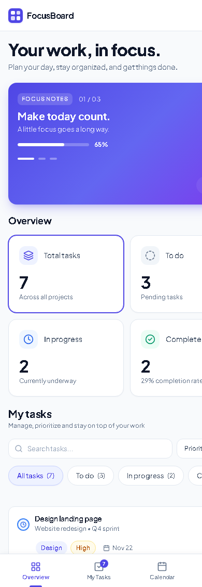
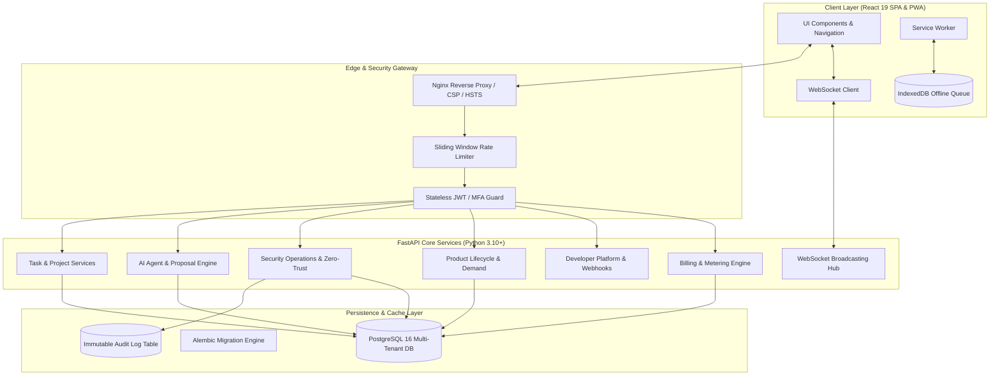
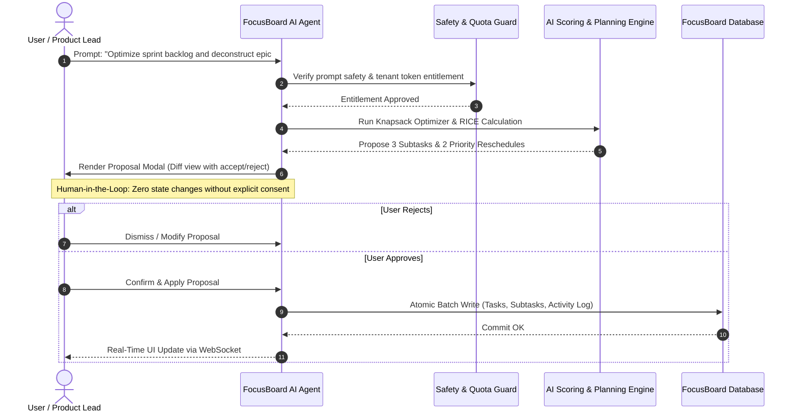
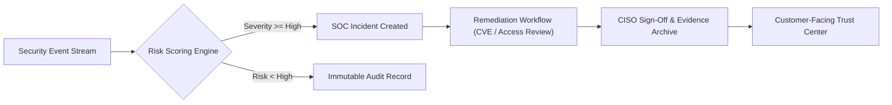

# FocusBoard — AI-Native Collaborative Task Management & Enterprise SaaS Platform

<div align="center">


**An intelligent, multi-tenant enterprise productivity platform bridging daily task execution, autonomous AI agents, business intelligence, zero-trust security governance, and end-to-end product lifecycle management.**

[Key Features](#-key-features) • [System Architecture](#-system-architecture) • [UI Showcase](#-ui--dashboard-showcase) • [Tech Stack](#-tech-stack) • [Quick Start](#-quick-start--execution) • [Testing](#-verification--testing) • [Documentation](#-enterprise-documentation)

---

</div>

## 📌 Project Objective

Modern enterprise teams face severe fragmentation across disconnected productivity tools, task boards, AI assistants, compliance portals, and analytical dashboards.

**FocusBoard** solves this challenge by serving as a unified **AI-Native Collaborative Productivity Ecosystem**:
1. **Intelligent Workload Planning**: Automates daily scheduling and task deconstruction through deterministic, transparent AI algorithms rather than black-box recommendations.
2. **Human-in-the-Loop Autonomous Agents**: Enables AI agents to plan, deconstruct, and execute multi-step workflows while enforcing strict user approval gates for state modifications.
3. **Enterprise Zero-Trust Governance**: Delivers continuous security posture monitoring, automated access reviews, vulnerability registries, immutable audit trails, and SOC 2 / ISO 27001 readiness.
4. **Product-Led Growth & Financial Intelligence**: Bridges operational tasks directly with RICE prioritization, customer feedback loops, subscription metering, and unit economics (MRR/ARR/LTV).
5. **Universal Accessibility & Ergonomics**: Built on a pure CSS3 custom property design system adhering strictly to WCAG AA color contrast standards and responsive across 320px–1440px+ viewports.

---

## 🖼️ UI & Dashboard Showcase

The FocusBoard interface provides an ergonomic, high-density dashboard optimized for quick cognitive processing, seamless navigation, and focused execution.

<div align="center">
  <table width="100%" style="border-collapse: collapse; margin: 20px 0;">
    <thead>
      <tr style="background-color: rgba(79, 70, 229, 0.05);">
        <th align="center" width="70%" style="padding: 12px; font-size: 15px;"><b>🖥️ Desktop Workspace (1440px)</b></th>
        <th align="center" width="30%" style="padding: 12px; font-size: 15px;"><b>📱 Mobile Ergonomics (390px)</b></th>
      </tr>
    </thead>
    <tbody>
      <tr>
        <td align="center" style="padding: 16px; vertical-align: top;">
          
        </td>
        <td align="center" style="padding: 16px; vertical-align: top;">
          
        </td>
      </tr>
      <tr>
        <td align="center" style="font-size: 13px; color: #64748B; padding: 8px;">
          <em>Executive dashboard featuring interactive Focus Notes carousel, real-time status metrics, and multi-facet task list</em>
        </td>
        <td align="center" style="font-size: 13px; color: #64748B; padding: 8px;">
          <em>PWA mobile layout with touch-first bottom navigation, swipe gestures, and offline-first IndexedDB reconciliation</em>
        </td>
      </tr>
    </tbody>
  </table>
</div>

---

## 🛠️ Tech Stack

| Domain | Technologies & Libraries |
| :--- | :--- |
| **Frontend Core** | React 19, Vite 8, JavaScript (ES2024), Context API, Custom Hooks |
| **UI & Styling** | Pure CSS3 (Zero runtime CSS-in-JS), CSS Custom Properties, Figma Design Tokens, Lucide React Icons |
| **PWA & Offline** | Web App Manifest, Service Workers (Cache-first App Shell), IndexedDB FIFO mutation queue |
| **Backend API** | FastAPI 0.115+, Python 3.10+, Uvicorn ASGI Server, Pydantic v2 validation |
| **Database & ORM** | PostgreSQL 16 (Production), SQLite (Test/CI), SQLAlchemy 2.0 (Sync/Async), Alembic (13 Migrations) |
| **Authentication & AuthZ** | Stateless JWT (HS256), Native Bcrypt Hashing, Custom Multi-Tenant RBAC, RFC 6238 TOTP MFA |
| **Real-Time Communication**| Authenticated WebSockets (`/api/v1/ws/workspaces/{id}`) with connection heartbeats and event broadcasting |
| **Security & Compliance** | OWASP Security Headers (CSP, HSTS, X-Frame-Options), CWE-1236 CSV Sanitization, Sliding Window Rate Limiting |
| **Testing & Quality** | Pytest, Pytest-Asyncio, Node Test Runner, Playwright E2E, WCAG AA Accessibility Automation |
| **DevOps & Containers** | Multi-Stage Dockerfile (Node 20 Alpine build + Nginx Alpine runtime), Docker Compose orchestration |

---

## 🏛️ System Architecture

### 1. High-Level Platform Architecture



### 2. Autonomous AI Agent & Proposal Execution Workflow



### 3. Zero-Trust Security Operations & Compliance Flow



---

## 🚀 Key Features & Project Outcomes

### 1. Task Management & Focused Ergonomics (Phases 1–10)
- **Fluid Task Operations**: Create, edit, prioritize, categorize, and complete tasks with sub-second feedback.
- **Focus Notes Carousel**: Interactive 3-slide visual carousel with keyboard navigation (`←`/`→`), mobile swipe gestures, and completion indicators.
- **Dynamic Task Filtering**: Composite filtering across status (`Todo`, `In Progress`, `Completed`), priority (`Low`, `Medium`, `High`), and text search.
- **Formula-Safe CSV Export**: Mitigates CWE-1236 formula injection by sanitizing leading `=`, `+`, `-`, and `@` characters.

### 2. Multi-User Authentication & Real-Time Collaboration (Phases 11–16)
- **Stateless JWT Security**: Secure token issuance, refresh handling, Bcrypt password hashing, and user profile management.
- **Shared Workspaces & Roles**: Multi-tenant workspace isolation with role-based access controls (`OWNER`, `ADMIN`, `MEMBER`).
- **Real-Time WebSockets**: Instant synchronization of workspace task mutations and comments over persistent WebSocket channels.

### 3. AI Productivity Assistant & Autonomous Agents (Phases 14, 22, 30)
- **Deterministic Prioritization**: 0–100 urgency score evaluating deadlines, task importance, and status momentum with human-readable rationale.
- **Daily Workload Knapsack Planner**: Time-block allocation bounded by user capacity (2–10 hours) with automated 15-minute rest intervals.
- **Autonomous Multi-Step Agents**: Agents capable of goal reasoning, task breakdown, and proposal creation with human approval gating.

### 4. Enterprise Security, SOC 2 / ISO 27001 & Zero-Trust (Phases 18, 23, 34, 43)
- **Security Operations Center (SOC)**: Continuous security posture scoring (0–100), real-time threat detection, and alert triage.
- **Identity & Access Governance**: Scheduled access review campaigns, entitlement decisions (`APPROVE`, `REVOKE`), and RFC 6238 TOTP MFA.
- **Vulnerability Management**: Centralized CVE tracking, severity classification (`CRITICAL`, `HIGH`, `MEDIUM`), and remediation workflows.
- **Public Trust Center**: Enterprise compliance posture, policy documents, and automated audit evidence export.

### 5. Product Lifecycle & Demand Intelligence (Phase 45)
- **Continuous Discovery**: Unified intake for customer feedback, user interviews, pain points, and idea discovery.
- **Feature Request Hub**: Community voting, automated deduplication, and merging.
- **Strategic Prioritization**: Mathematical evaluation combining RICE (Reach × Impact × Confidence / Effort) and ICE frameworks.
- **Initiatives & Product Roadmap**: Timeline planning across `Q1`–`Q4` horizons linked to active tasks and user stories.
- **Experimentation Engine**: A/B testing with randomized deterministic hashing and conversion event tracking.

### 6. Developer Platform, Observability & Automation (Phases 33, 39, 41)
- **Scoped Developer APIs**: Scoped API key generation with expiration and permission boundaries.
- **Event-Driven Webhooks**: HMAC-SHA256 signature verification and automatic retry policies.
- **No-Code Automation Builder**: Configurable trigger-condition-action workflow engine.
- **Platform Observability**: Unified status console, dependency health checks, and incident response tracking.

---

## ⚡ Quick Start & Execution

### Prerequisites
- Docker & Docker Compose **OR**
- Node.js 20+ & Python 3.10+

### Option A: Run via Docker Compose (Recommended)
```bash
# Clone the repository
git clone https://github.com/mubashirhussen/Focus-board.git
cd Focus-board

# Spin up PostgreSQL, Backend API, and Frontend Container
docker-compose up --build -d
```
- **Frontend Application**: `http://localhost:3000`
- **FastAPI Interactive Docs**: `http://localhost:8000/docs`
- **Backend Health Probe**: `http://localhost:8000/health`

---

### Option B: Local Development Setup

#### 1. Backend Setup
```bash
cd backend

# Create and activate Python virtual environment
python -m venv venv
.\venv\Scripts\activate      # Linux/macOS: source venv/bin/activate

# Install dependencies
pip install -r requirements.txt

# Run database migrations
alembic upgrade head

# Start FastAPI development server
uvicorn app.main:app --reload --port 8000
```

#### 2. Frontend Setup
```bash
# In the root repository directory
npm install

# Start Vite development server
npm run dev
```
Open `http://localhost:5173` in your browser.

---

## 🧪 Verification & Testing

FocusBoard enforces rigorous automated test coverage across both frontend and backend layers:

### Backend Pytest Suite
```bash
cd backend
$env:PYTHONPATH="."
.\venv\Scripts\pytest tests/ -v
```
**Coverage Highlights:**
- `test_security_intelligence_and_product_lifecycle.py`: Validates SOC posture, CVE tracking, access reviews, RICE/ICE scoring, and A/B experiments.
- `test_migrations_validation.py`: Verifies full Alembic migration chain across all 13 schema revisions.
- `test_resilience.py`: Distributed trace correlation, Prometheus metric exporter, and 404 security handling.
- `test_multi_tenant_security.py`: Cross-tenant boundary isolation and data leakage prevention.
- `test_performance_benchmarks.py`: API latency (<100ms) and Bcrypt authentication throughput.

### Frontend Test & Production Build
```bash
# Execute full frontend verification suite
npm test

# Build production bundle
npm run build
```

---

## 📚 Enterprise Documentation

Comprehensive operational, architecture, and developer manuals are available in the repository:

| Document | Purpose |
| :--- | :--- |
| [`PRODUCT_OVERVIEW.md`](./PRODUCT_OVERVIEW.md) | High-level product capabilities and functional breakdown |
| [`TECHNICAL_HANDOVER.md`](./TECHNICAL_HANDOVER.md) | Architectural specifications, schema designs, and operational handover |
| [`SRE_ARCHITECTURE.md`](./SRE_ARCHITECTURE.md) | SRE reliability patterns, SLOs/SLIs, and zero-downtime scaling |
| [`SECURITY_GOVERNANCE.md`](./docs/SECURITY_GOVERNANCE.md) | SOC 2 / ISO 27001 policies and zero-trust security controls |
| [`STRATEGIC_INTELLIGENCE_GUIDE.md`](./docs/STRATEGIC_INTELLIGENCE_GUIDE.md) | Executive decision support, SWOT, and competitor analysis |
| [`FINANCIAL_INTELLIGENCE.md`](./docs/FINANCIAL_INTELLIGENCE.md) | MRR, ARR, churn, LTV, and unit economics architecture |

---

## 📄 License & Author

Developed by **Sheik Mubashir Hussen**.  
Designed and engineered for enterprise-grade performance, scalability, and security.
