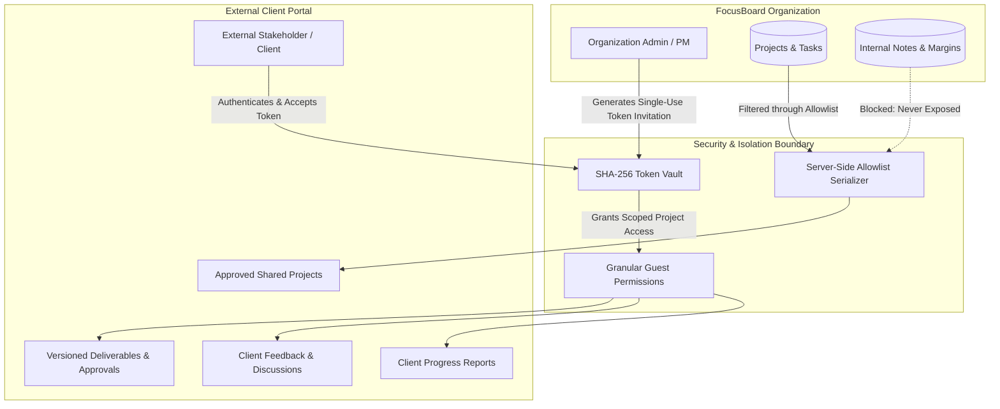
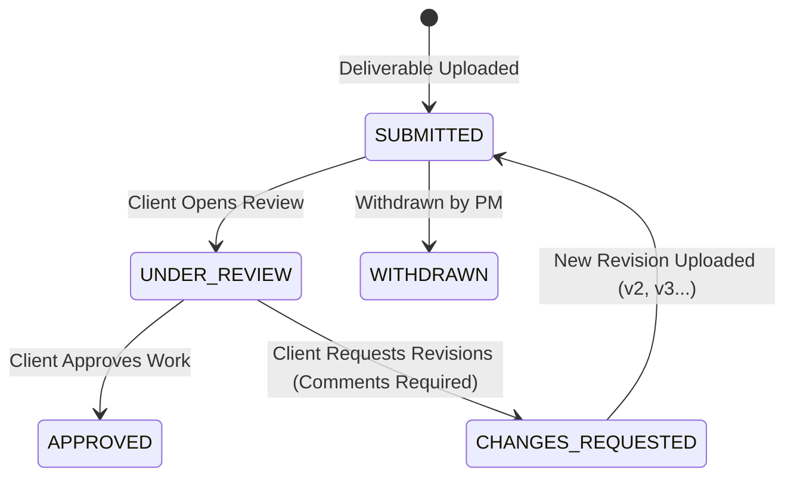

# FocusBoard Module B53: Client & Guest Portal

## 1. Executive Summary & Architecture
The **Client & Guest Portal (Module B53)** introduces external stakeholder collaboration capabilities to FocusBoard. It allows organizations to securely invite external clients, partners, contractors, and auditors to review project milestones, inspect versioned deliverables, submit change requests or approvals, participate in client-visible discussions, and download authorized project assets—all while keeping internal task descriptions, employee assignments, financial margins, and confidential activity logs strictly protected behind server-side allowlists.

---

## 2. Guest Roles & Permission Hierarchy

Guest access is explicitly scoped per project. External users never receive default organization membership or visibility into unshared workspaces:

| Guest Role | Summary & Milestones | Comments & Discussions | Upload Deliverables | Deliverable Approvals | Client Reports |
|---|:---:|:---:|:---:|:---:|:---:|
| **Client Viewer** | Read-Only | Read-Only | Denied | Denied | Read-Only |
| **Client Collaborator** | Read-Only | Read & Write | Permitted | Denied | Read-Only |
| **Client Approver** | Read-Only | Read & Write | Denied | Permitted (Approve / Request Changes) | Read-Only |
| **Custom** | Configurable | Configurable | Configurable | Configurable | Configurable |

---

## 3. Cryptographic Invitation Workflow

1. **Invitation Generation**: Organization administrators define the guest email, name, company, role, expiration (1–30 days), and target projects.
2. **Cryptographic Token Hashing**: The system creates a 32-byte URL-safe raw token (`secrets.token_urlsafe(32)`). Only the SHA-256 digest (`hashlib.sha256`) is stored in `guest_invitations.token_hash`.
3. **Acceptance & Binding**:
   - The recipient authenticates.
   - The token hash is looked up; status must be `PENDING` and expiration must be in the future.
   - The authenticated user's email is strictly verified against `invitation.guest_email` to prevent identity hijack.
   - An active `GuestProfile` is created/updated, and `GuestProjectAccess` grants are issued for designated project IDs.
   - The token is stamped `status = "ACCEPTED"` and cannot be reused.
4. **Revocation**: Admins can revoke pending invitations immediately, invalidating the token.

---

## 4. Deliverables & Approval Lifecycle

Deliverables follow a structured state transition:

- **Mandatory Comments on Revisions**: When a client requests changes (`CHANGES_REQUESTED`), review feedback is mandatory to avoid ambiguity.
- **Historical Version Ledger**: Every file update increments `version_number` and appends an immutable entry to `ClientDeliverableVersion`.

---

## 5. Security & Privacy Guarantees

- **Server-Side Field Allowlist**: External client endpoints (`/api/v1/client-portal/...`) serialize project and task data through strict Pydantic schemas. Private budget records, employee hourly rates, internal risk metrics, and private task notes are never returned in JSON payloads.
- **Immediate Revocation**: Suspending or revoking a guest account immediately invalidates all `GuestProjectAccess` records, instantly blocking project views, comment submissions, and document downloads.
- **No Organization Privilege Escalation**: Guests cannot view organization members, create internal projects, or alter workspace governance settings.
- **Audit Logging**: Every invitation acceptance, project view, document download, deliverable approval, and access suspension is logged to `GuestActivityLog`.

---

## 6. API Reference

All routes are mounted under `/api/v1/client-portal`:

| Method | Endpoint | Description |
|---|---|---|
| `POST` | `/client-portal/invitations` | Issue single-use tokenized invitation. |
| `GET` | `/client-portal/invitations` | List organization invitations. |
| `POST` | `/client-portal/invitations/accept` | Accept invitation with token verification. |
| `POST` | `/client-portal/invitations/{id}/revoke` | Revoke invitation. |
| `POST` | `/client-portal/invitations/{id}/resend` | Renew and regenerate token. |
| `GET` | `/client-portal/guests` | List guest directory. |
| `POST` | `/client-portal/guests/{id}/suspend` | Suspend guest access immediately. |
| `POST` | `/client-portal/guests/{id}/reactivate` | Reactivate guest access. |
| `DELETE` | `/client-portal/guests/{id}` | Revoke guest from organization. |
| `GET` | `/client-portal/dashboard` | Client-facing dashboard of authorized projects. |
| `GET` | `/client-portal/projects/{id}` | Client project overview with allowlisted fields. |
| `GET` | `/client-portal/projects/{id}/visibility` | Get project sharing and visibility settings. |
| `PUT` | `/client-portal/projects/{id}/visibility` | Update sharing settings. |
| `POST` | `/client-portal/projects/{id}/share` | Share project with guest. |
| `DELETE` | `/client-portal/projects/{id}/guests/{id}`| Remove guest from project. |
| `GET` | `/client-portal/projects/{id}/deliverables` | List project deliverables. |
| `POST` | `/client-portal/projects/{id}/deliverables` | Submit project deliverable. |
| `POST` | `/client-portal/deliverables/{id}/review` | Approve or request changes. |
| `GET` | `/client-portal/projects/{id}/feedback` | List client feedback. |
| `POST` | `/client-portal/projects/{id}/feedback` | Submit client feedback. |
| `GET` | `/client-portal/projects/{id}/comments` | List client-visible comments. |
| `POST` | `/client-portal/projects/{id}/comments` | Post comment. |
| `GET` | `/client-portal/projects/{id}/documents` | List shared documents. |
| `GET` | `/client-portal/projects/{id}/reports` | List client progress reports. |
| `POST` | `/client-portal/projects/{id}/reports` | Generate client report. |
| `GET` | `/client-portal/settings` | Retrieve portal governance settings. |
| `PUT` | `/client-portal/settings` | Update portal settings. |
| `GET` | `/client-portal/audit-logs` | Retrieve guest activity audit logs. |

---

## 7. Automated Testing Suite

1. **Backend Pytest** (`backend/tests/test_client_portal_b53.py`):
   - `test_client_portal_settings_and_invitation_creation`: Verified invitation token generation and SHA-256 storage.
   - `test_accept_invitation_and_project_grant`: Verified email identity matching, profile creation, and token single-use semantics.
   - `test_client_portal_dashboard_strict_isolation`: Verified client dashboard displays only authorized projects and rejects unshared projects with 403 Forbidden.
   - `test_client_deliverable_review_and_approval`: Verified deliverable lifecycle, change requests with mandatory comments, and approvals.
   - `test_client_feedback_and_comments_workflow`: Verified feedback submission, replies, and client comment threads.
   - `test_client_report_generation`: Verified progress report generation.
   - `test_guest_suspension_and_access_revocation`: Verified immediate 403 access blocking on suspension and restoration upon reactivation.
2. **Frontend Unit Tests** (`tests/frontend/client_portal_b53.test.js`):
   - Verified 28 client API endpoints.
   - Verified SHA-256 token hashing equivalence.
   - Verified guest role permission resolution.
   - Verified deliverable review decision validation.
   - Verified approved project progress calculation.
   - Verified server-side allowlist serialization.
