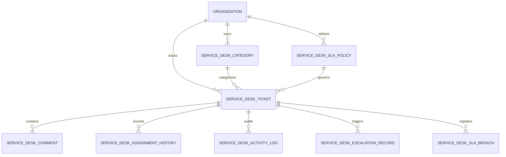
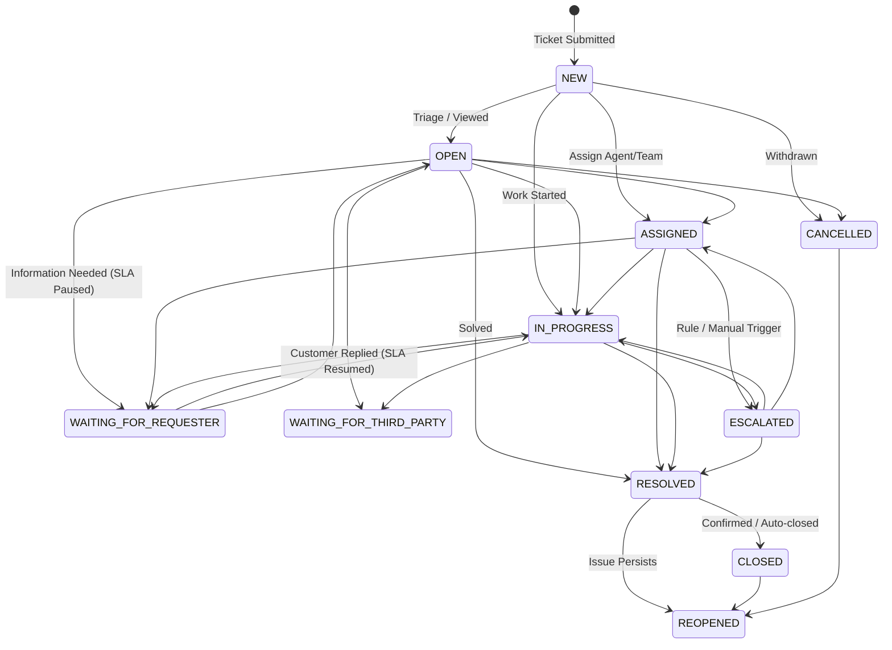

# FocusBoard Module B52: Service Desk & SLA Management

## 1. Executive Summary & Purpose
The **Service Desk & SLA Management (Module B52)** provides internal IT, platform operations, and customer support organizations with enterprise-grade ticket resolution workflows, business hours-aware Service Level Agreement (SLA) calculations, multi-channel collaboration, and automated escalation management.

Fully integrated into FocusBoard's multi-tenant architecture, Module B52 connects directly with existing Projects, Tasks, Users, Teams, Organizations, Notifications, Analytics, B47 Predictive Intelligence, B48 Time Tracking, B49 Resource Management, B50 Strategic Goals, and B51 Project Planning.

---

## 2. Architecture & Data Model

Module B52 models are persisted in PostgreSQL / SQLite with strict foreign keys, cascade safety, and tenant scoping:

### Persisted Entities:
1. `ServiceDeskCategory`: Hierarchical issue taxonomy (Incident, Service Request, Problem, Change Request, Bug) with default team routing.
2. `ServiceDeskSLAPolicy`: Configurable first-response and resolution targets, priority mappings (LOW, MEDIUM, HIGH, URGENT, CRITICAL), business hours schedules (e.g. 09:00 - 17:00), working days (MON-FRI), and pause-when-waiting settings.
3. `ServiceDeskTicket`: Central ticket entity with sequential, collision-safe ticket numbers (`SD-1001`, `SD-1002`), priority, lifecycle status, SLA target timestamps, pause accumulators, and linked project/task IDs.
4. `ServiceDeskComment`: Multi-channel conversation timeline supporting public customer replies and confidential agent/admin internal notes.
5. `ServiceDeskAssignmentHistory`: Audit ledger capturing previous vs new agent, delegator ID, and timestamp.
6. `ServiceDeskActivityLog`: Full chronological event log auditing status changes, priority shifts, and SLA recalculations.
7. `ServiceDeskEscalationRule`: Trigger condition matrix (priority, elapsed time, unassigned flag) with automated actions (priority bump, team reassignment, notification delivery).
8. `ServiceDeskEscalationRecord`: Record of fired escalation rules preventing duplicate trigger loops.
9. `ServiceDeskSLABreach`: Idempotent breach ledger documenting response or resolution violations, elapsed minutes, and responsible parties.

---

## 3. SLA Business Calendar Engine

Unlike naive 24/7 countdown timers, FocusBoard B52 computes SLA deadlines by traversing only scheduled business hours and designated working days:

- **Traversing Logic**: When a ticket is opened outside of business hours or on a weekend/holiday, the SLA start clock advances to the opening hour of the next valid business day.
- **Multi-Day Deadlines**: Target minutes that exceed remaining time on the current business day carry over to subsequent business days at `business_hours_start`.
- **SLA Pause on Requester Awaiting**: When a ticket status transitions to `WAITING_FOR_REQUESTER`, the SLA countdown is suspended. Upon exiting this state, the accumulated pause duration is added as an offset to both `first_response_due_at` and `resolution_due_at`.

---

## 4. Ticket Lifecycle & State Machine

---

## 5. Security & Internal Note Privacy
- **Strict Role-Based Access Control (RBAC)**: Support agents, owners, and administrators have full visibility over confidential comments (`is_internal_note=True`).
- **Requester Concealment**: Requests made by customers/members automatically filter out internal notes at the query and serialization layers.
- **Authoring Protection**: Standard members attempting to post with `is_internal_note=True` are rejected with `403 Forbidden`.
- **First Response Qualification**: Internal notes do not satisfy the SLA first response deadline; only an agent's public communication to the requester stamps `first_response_at`.

---

## 6. API Reference

All endpoints are mounted under `/api/v1/service-desk`:

| Method | Endpoint | Description |
|---|---|---|
| `GET` | `/service-desk/tickets` | Query tickets with filters (`view`, `status`, `priority`, `agent_id`, `search`, `limit`, `skip`). |
| `POST` | `/service-desk/tickets` | Submit a new ticket; calculates SLA deadlines and logs activity. |
| `GET` | `/service-desk/tickets/{id}` | Retrieve comprehensive ticket details with audit history and breach records. |
| `POST` | `/service-desk/tickets/{id}/status` | Execute state machine status transition with SLA pause/resume handling. |
| `POST` | `/service-desk/tickets/{id}/assign` | Assign or reassign ticket to an agent or team with audit history. |
| `POST` | `/service-desk/tickets/{id}/escalate` | Manually or systematically trigger escalation with priority bump. |
| `GET` | `/service-desk/tickets/{id}/comments` | Retrieve ticket conversation thread (internal notes concealed for requesters). |
| `POST` | `/service-desk/tickets/{id}/comments` | Post a public message or confidential internal note. |
| `GET` | `/service-desk/categories` | List active support categories. |
| `POST` | `/service-desk/categories` | Create organizational support category. |
| `GET` | `/service-desk/sla-policies` | List SLA policies and thresholds. |
| `POST` | `/service-desk/sla-policies` | Create or update organization SLA policy. |
| `GET` | `/service-desk/escalation-rules` | List configured escalation rules. |
| `POST` | `/service-desk/escalation-rules` | Define new SLA escalation rule. |
| `POST` | `/service-desk/sla/recalculate` | Re-evaluate SLA breach and at-risk statuses across open tickets. |
| `GET` | `/service-desk/dashboard` | Retrieve real-time operational dashboard metrics (SLA compliance, MTTR). |
| `GET` | `/service-desk/reports/performance` | Retrieve agent and team performance analytics. |

---

## 7. Automated Testing Suite

The implementation is verified by dual automated test suites:
1. **Backend Pytest** (`backend/tests/test_service_desk_b52.py`):
   - `test_service_desk_category_and_sla_policy_seeding`: Verified default categories and SLA policy generation.
   - `test_create_support_ticket_with_sla_deadlines`: Verified sequential `SD-XXXX` number generation and business hours deadline calculation.
   - `test_ticket_assignment_and_history`: Verified agent assignment and audit ledger records.
   - `test_ticket_status_workflow_transitions`: Verified allowed transitions and rejection of invalid state jumps.
   - `test_ticket_conversations_and_internal_note_confidentiality`: Verified requester privacy restrictions and public vs internal note segregation.
   - `test_sla_breach_detection_and_recalculation`: Verified idempotent breach detection.
   - `test_ticket_escalation_and_dashboard_metrics`: Verified rule triggering, priority bumps, and dashboard KPI aggregation.
2. **Frontend Unit Tests** (`tests/frontend/service_desk_b52.test.js`):
   - Verified API service client coverage (17 endpoints).
   - Validated multi-day business hours calendar calculations.
   - Validated state machine transitions and SLA pause offset mechanics.
   - Validated internal note filtering and confidentiality checks.
   - Validated SLA risk and breach evaluation heuristics.
